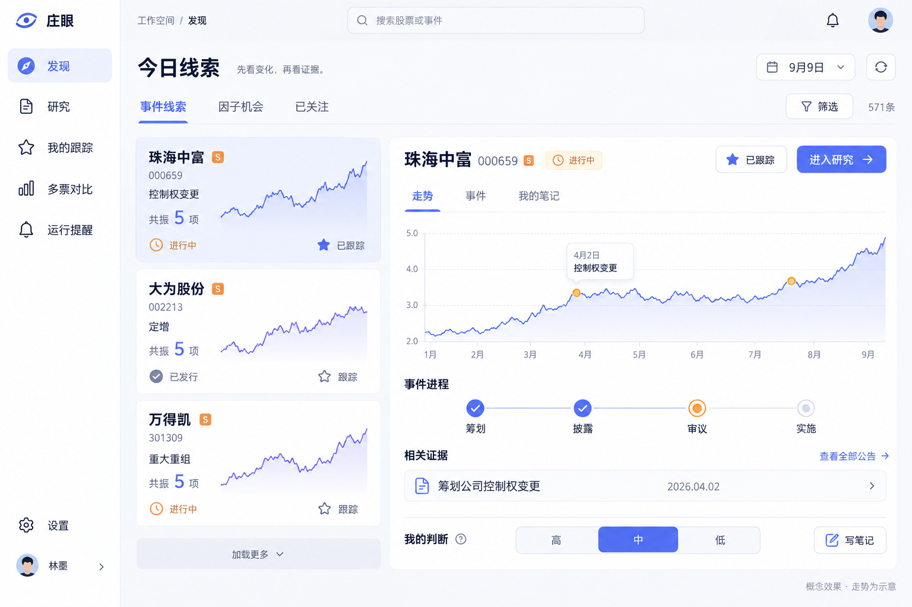
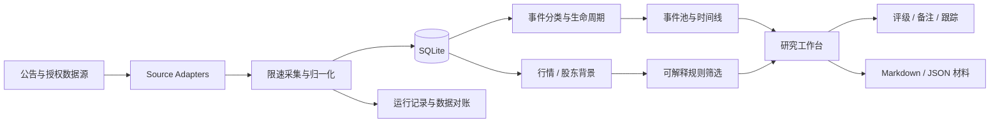

<div align="center">

# 资本事件研究台

### Capital Events Intelligence

面向中国 A 股公司行动与资本市场事件的本地事件驱动研究工作流

<p>
  
  
  
  
</p>

<p><i>先看变化，再看证据；先还原事件，再做人工判断。</i></p>

</div>

> 这是一个研究整理工具，不是荐股工具、交易系统，也不对“庄股”或市场操纵作判断。

## 项目简介

公司公告、监管进展、股东变化和市场数据往往分散在不同来源里。研究员真正耗时的部分，通常不是看见一条公告，而是把同一件事的多个节点串起来，判断证据是否完整，再决定是否值得继续跟踪。

**资本事件研究台**把这条路径拆成可复跑、可检查的步骤：

```text
公告 / 数据源
    → 归一化与去重
    → 事件分类
    → 事件生命周期
    → 市场与股东背景
    → 可解释的规则筛选
    → 人工复核、备注与跟踪
    → Markdown / JSON 研究材料
```

项目的重点不是生成一个看起来很精确的分数，而是让研究线索、原始证据、数据缺口和人工判断彼此可追溯。

## Demo

### 1. 今日线索与单股研究工作台



截图来自现有“庄眼”Demo：左侧按事件聚合今日线索，右侧进入单股研究台，查看走势、事件进度、相关公告和人工判断。图中走势为示意，截图用于展示产品信息架构与交互方向。

### 2. 从公告到事件时间线

仓库附带一份完全合成的事件样例，方便在不接入真实数据的情况下理解数据流：

👉 [查看合成事件时间线](examples/synthetic-event-timeline.md)

示例中的公司、代码、日期、链接和结论均为占位内容，不代表真实发行人或投资机会。

## 核心能力

| 能力 | 解决的问题 | 当前实现 |
| --- | --- | --- |
| 事件识别 | 从公告标题和正文线索中识别公司行动 | 控制权变更、并购重组、定增、资产交易、股东变化等 |
| 生命周期 | 把同一事件的多个阶段串起来 | 筹划、披露、审议、问询、批复、实施、终止 |
| 证据留痕 | 结论能够回到原始材料 | 来源、公告日期、标题、原文链接、节点记录 |
| 数据上下文 | 事件之外还需要看什么 | 行情、股东户数、公开榜单等可用字段 |
| 研究筛选 | 从大量事件中优先看什么 | 可配置规则命中与信号共振计数 |
| 人工协作 | 让系统服务研究，而不是替代研究 | 评级、备注、跟踪名单、Markdown/JSON 导出 |

## 系统结构



### 为什么这样设计

- **事件证据与行情背景分开。** 没有行情数据时，公告事件仍然可以被复核；没有公告证据时，行情变化也不会被包装成事件结论。
- **规则可解释。** 筛选结果展示命中的规则、数据缺口和共振次数，不把启发式条件伪装成预测模型。
- **来源差异可见。** 首选结构化来源，必要时走备用来源，并在运行记录中保留阶段状态。
- **人工判断有位置。** 评级、备注和打开原文是工作流的一部分，不是系统之外的临时动作。

## 快速运行

本项目默认是本地、单用户、可复现的研究环境，不需要生产服务器或账号。

```bash
# 安装 Python 依赖
uv sync --extra dev

# 初始化本地 SQLite 数据库
uv run python scripts/init_db.py

# 构建前端
cd frontend
npm ci
npm run build
cd ..

# 在项目根目录的 .env 中设置 ZM_ADMIN_PASSWORD（至少 16 个字符，使用随机密码）
# 启动本地服务
uv run uvicorn zhuang_monitor.main:app --host 127.0.0.1 --port 8317
```

打开 <http://127.0.0.1:8317>，使用用户名 `admin` 和设置的密码登录。可用 `ZM_ADMIN_USERNAME` 自定义用户名。远程使用时保留回环监听，并由 HTTPS 反向代理接入。

> 真实数据刷新脚本会访问外部数据源，可能受到网络、限速、授权和上游页面变化影响。建议先阅读源配置，再运行回填或全量刷新。

## 工程验证

- Python：`306 passed, 2 skipped`
- 前端：TypeScript 检查通过，Vite 生产构建通过
- 数据层：SQLite schema 初始化与重复运行保持幂等
- 测试：覆盖事件规则、生命周期、采集、批处理、API、扫描、材料导出和通知契约

前端构建目前有一个 bundle size 提示，不影响构建成功；后续可以通过拆分 ECharts 等依赖继续优化首屏体积。

## 目录结构

```text
src/zhuang_monitor/
  events/       事件规则与生命周期状态机
  sources/      数据源适配器与字段归一化
  db.py         SQLite schema 与连接管理
  ingest.py     批量采集与刷新阶段
  scanner.py    可解释的规则筛选
  material.py   Markdown / JSON 研究材料导出
  api.py        本地 REST API
frontend/src/   React 研究工作台
scripts/        初始化、刷新、扫描、导入和导出脚本
tests/          离线单测与 API 契约测试
examples/       合成数据与隐私安全示例
```

为保持已有代码兼容性，Python import package 目前仍然叫 `zhuang_monitor`；这不会改变 GitHub 仓库对外使用的项目名称 `capital-events-intelligence`。

## 数据源、许可证与安全边界

- 本仓库提供适配器和研究工作流代码，不授予任何上游网站、数据或商标的再分发权。
- 数据源的访问权限、频率限制、商业许可和使用条款由部署者自行确认。
- 可选的 iFinD MCP 通道只允许接入操作者自己的授权服务；本仓库不包含生产端点、密钥、Cookie 或账户白名单。
- 不要提交数据库、浏览器配置、个人研究笔记、Provider key、部署凭证或真实企业数据。
- 发布前应继续检查历史提交，并确认第三方依赖和数据源条款。

更多说明见 [THIRD_PARTY_NOTICES.md](THIRD_PARTY_NOTICES.md)。

## 当前明确不做

- 不执行交易、下单或自动调仓。
- 不生成自动投资建议或价格预测。
- 不声称可以识别违法行为或市场操纵。
- 不包含多用户 SaaS、公开托管后台或自动 Agent 对话层。
- 不把缺失数据填成“看起来完整”的确定性结论。

## 后续路线

1. 增加更多经过许可审查、带离线契约测试的数据源适配器。
2. 将通用事件引擎与特定研究方法进一步解耦。
3. 完善全合成 Demo 数据和一键演示脚本。
4. 在不牺牲可追溯性的前提下优化前端首屏加载。

## 免责声明

本项目仅用于教育和研究工作流，不构成投资建议，不保证数据完整性或准确性，也不替代对原始公告的独立核验。使用者应遵守适用法律、交易所规则、数据提供方条款和许可证要求。

## License

原始代码采用 [MIT License](LICENSE)。上游数据、网站、商标、接口和第三方服务仍受其各自权利人约束。
